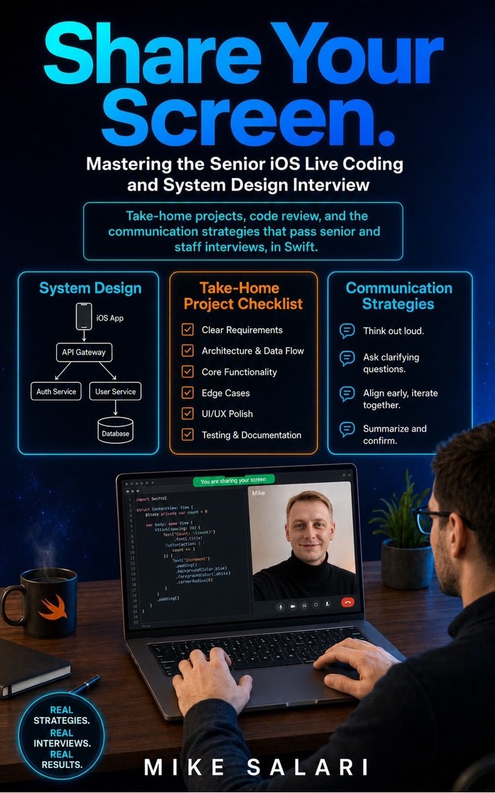

# Minute six

**Free sample of *Share Your Screen: Senior iOS Live Coding and System Design Interview***

Where senior iOS candidates lose the live round, and what the interviewer is writing down while it happens.

By **Mike Salari** · Staff mobile engineer · 500+ technical interviews from the hiring side

[**Read on desktop**](Share-Your-Screen-sample-desktop.pdf) · [**Read on your phone**](Share-Your-Screen-sample-mobile.pdf) · [**Get the full book**](https://salari.dev/books/share-your-screen-live-coding-ios/?utm_source=github&utm_medium=sample&utm_campaign=share_your_screen_field_guide_2026)

---

## You can build it. You still lose the round.

Two candidates get the same prompt: build a small feed that loads images into reusable cells. The first reads it, nods, and starts typing. Ten minutes of silence. The code works, until a cell scrolls off screen mid-load and a stale image lands in the wrong row.

The second says, before touching the keyboard: "the interesting part here is cell reuse, so I want to cancel on reuse. I will come back to that on purpose."

Same skill. Different round. The code is evidence, and so is everything you say while you write it.

## What's inside

- **The first five minutes, before you type.** Six moves for the opening of a live round, with the sentence to say at each one.
- **A real round that passed.** The opening of a senior token-refresh round at a payments company, from the transcript, with what the interviewer noticed. It stops at the question that decided the round.
- **When your mind goes blank.** The first two steps of the reset sequence.

8 pages on desktop, 10 on a phone. Ten minutes to read.

| Edition | Best for | Pages | Open |
| --- | --- | ---: | --- |
| **Desktop** | Laptop, large screen, print | 8 | [Desktop PDF](Share-Your-Screen-sample-desktop.pdf) |
| **Mobile** | Reading on a phone, no zooming | 10 | [Mobile PDF](Share-Your-Screen-sample-mobile.pdf) |

Free, no email, no sign-up.

## What readers say

Rated 5.0 from 4 reader reviews on [salari.dev](https://salari.dev/books/share-your-screen-live-coding-ios/?utm_source=github&utm_medium=sample&utm_campaign=share_your_screen_field_guide_2026).

> The test-first opening strategy and the mock transcripts gave me a reliable script for the first five minutes, and momentum carried me through the rest.
>
> **David H.**, iOS Engineer

> Most iOS interview books stop at 'here's the answer.' This one shows you the entire conversation: the interviewer's follow-ups, where candidates stall, and what a strong recovery looks like. I ran two of the annotated mocks with a colleague before my onsite, and I got the offer.
>
> **Daniel K.**, Senior iOS Engineer

> What I love most is that Mike shares his real experience instead of just listing questions and answers. ... this book has already changed the way I think about live coding sessions.
>
> **Ivan G.**, verified purchase

> If you have an upcoming technical interview and even if you think you are prepared you should buy Share Your Screen.
>
> **Aurelian Gavrila**, Senior iOS Developer

## The full book

Most interview books teach you what to answer. This one trains you for what happens after your first answer: the follow-up that changes the problem, the failing test, the design decision you have to defend, the moment your build breaks and the interviewer is still watching.

- Seven annotated mock interviews, minute by minute, each with an interviewer runsheet and scorecard.
- Twelve case studies, two of them real rounds, including the full version of the round in this sample.
- 82 worked problems with Swift solutions and tests.
- A companion Swift package with 76 tests and nine exercises.
- 603 pages, PDF and EPUB, with free lifetime updates.

**[Get the full book](https://salari.dev/books/share-your-screen-live-coding-ios/?utm_source=github&utm_medium=sample&utm_campaign=share_your_screen_field_guide_2026)**

## Who it's for

Mid-to-senior iOS engineers preparing for senior and staff loops. It assumes you can already build; it trains how you perform.

## Sharing and copyright

© 2026 Mike Salari. All rights reserved. Share the link to this repository freely. The PDFs are free to read for personal use, not for redistribution or commercial use.

[salari.dev](https://salari.dev) · [LinkedIn](https://www.linkedin.com/in/mike-salari/)
